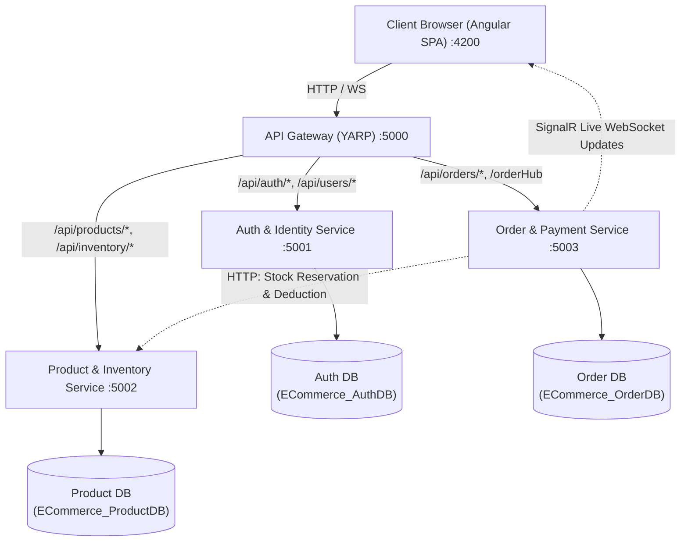
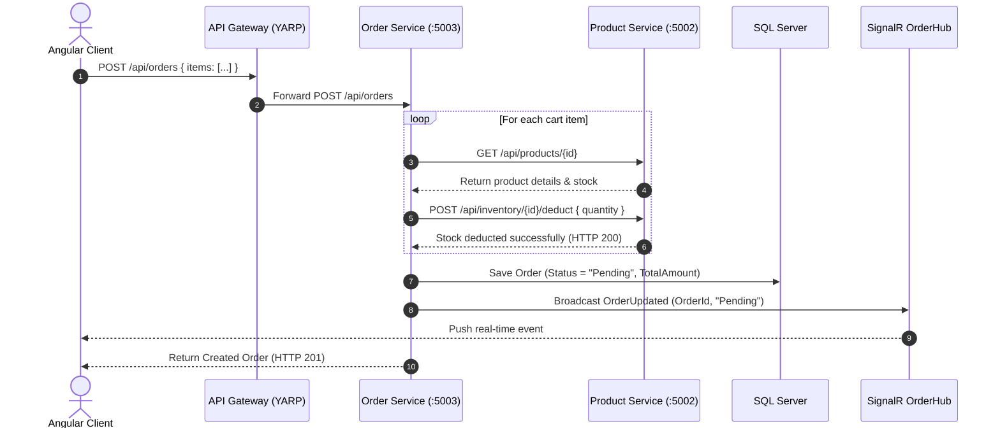
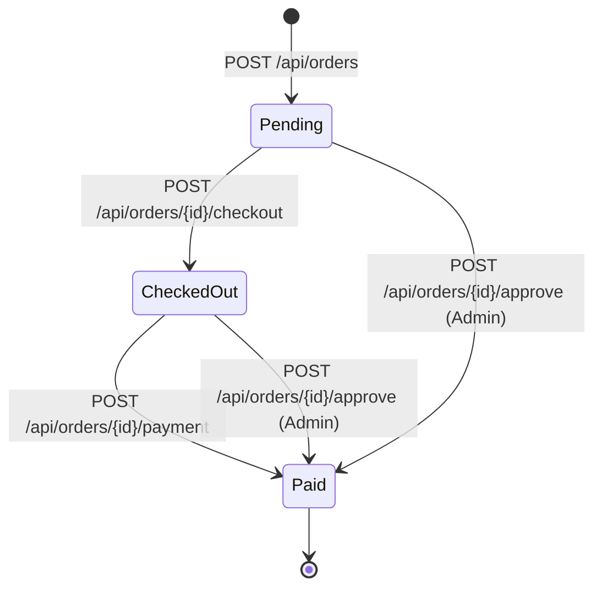

# Enterprise Microservices Architecture & Engineering Guide

This document provides complete technical documentation for the distributed microservices architecture of the E-Commerce platform built with **.NET 10** and **Angular 16**.

---

## 1. System Topology & Architecture

The solution uses an asynchronous and synchronous microservices pattern with a central API Gateway powered by **Microsoft YARP (Yet Another Reverse Proxy)**. Each domain is decoupled into its own bounded context with an independent database, business services, and repositories.



---

## 2. Microservices Breakdown

| Service | Port | Technology | Primary Responsibilities | Database |
| :--- | :--- | :--- | :--- | :--- |
| **ApiGateway** | `5000` | ASP.NET Core, YARP | Route matching, cluster forwarding, CORS policy, WebSocket proxy | N/A |
| **AuthService** | `5001` | .NET 10, EF Core, JWT | User registration, PBKDF2 SHA-256 hashing, JWT issuance | `ECommerce_AuthDB` |
| **ProductService** | `5002` | .NET 10, EF Core, ClosedXML | Product catalog CRUD, stock management, Excel/CSV bulk import | `ECommerce_ProductDB` |
| **OrderService** | `5003` | .NET 10, EF Core, SignalR | Order lifecycle, payment processing, stock coordination, WebSockets | `ECommerce_OrderDB` |
| **AIService** | `5004` | .NET 10, Microsoft AI Foundry, Azure OpenAI | Multi-agent customer service, semantic product recommendations, enterprise RAG, responsible AI guardrails | In-Memory Vector Store |

---

## 3. Inter-Service Communication & Data Flow

### Order Creation & Stock Reservation Pipeline

When a customer checks out their cart, the Order Service coordinates directly with the Product Service before committing the order state:



---

## 4. API Endpoint Contracts & Specifications

### 🔐 Authentication Service (`/api/auth`)

#### `POST /api/auth/register`
* **Access**: Public / Anonymous
* **Request Body**:
  ```json
  {
    "name": "Jane Doe",
    "email": "jane@example.com",
    "password": "Password123!",
    "role": "Customer"
  }
  ```
* **Security Validation**: Unauthenticated callers cannot register with `role: "Admin"`. Elevating to Admin role returns `HTTP 403 Forbidden`.
* **Responses**:
  * `200 OK`: Returns created user object with hashed password stripped.
  * `400 Bad Request`: Email already exists.

#### `POST /api/auth/login`
* **Access**: Public / Anonymous
* **Request Body**:
  ```json
  {
    "email": "admin@local",
    "password": "Admin123!"
  }
  ```
* **Responses**:
  * `200 OK`: `{"token": "eyJhbGci..."}` (Bearer JWT valid for 6 hours with `sub`, `email`, and `role` claims).
  * `401 Unauthorized`: Invalid credentials.

---

### 📦 Product & Inventory Service (`/api/products`, `/api/inventory`)

#### `GET /api/products`
* **Access**: Public / Anonymous
* **Cache**: Cached in-memory via `IMemoryCache` with automatic invalidation upon product mutations.
* **Response**: List of products including real-time stock quantity:
  ```json
  [
    {
      "id": 1,
      "name": "Wireless Noise-Canceling Headphones",
      "description": "High-fidelity audio with active noise cancellation.",
      "price": 199.99,
      "category": "Electronics",
      "quantity": 25
    }
  ]
  ```

#### `POST /api/products` *(Admin Only)*
* **Headers**: `Authorization: Bearer <token>`
* **Creates a product and invalidates cache**.

#### `POST /api/products/import` *(Admin Only)*
* **Multipart Form**: `file` (`.xlsx` or `.csv`)
* **Parsing**: Uses ClosedXML to parse Excel rows `(Name, Description, Price, Category, Quantity)`.

#### `POST /api/inventory/{productId}/deduct` *(Internal / Anonymous)*
* **Deducts quantity during checkout atomically**.
* **Responses**:
  * `200 OK`: Stock successfully deducted.
  * `400 Bad Request`: Insufficient stock or product not found.

---

### 🛒 Order Service (`/api/orders`, `/orderHub`)

#### Order State Machine



#### `POST /api/orders`
* **Headers**: `Authorization: Bearer <token>`
* **Request Body**:
  ```json
  {
    "userId": 2,
    "items": [
      { "productId": 1, "quantity": 2 }
    ]
  }
  ```
* **Responses**:
  * `201 Created`: Returns created order with `id`, `totalAmount`, `status: "Pending"`.
  * `400 Bad Request`: Insufficient stock or invalid product.

#### `POST /api/orders/{id}/checkout`
* Transitions status from `Pending` $\rightarrow$ `CheckedOut`. Broadcasts update to SignalR subscribers.

#### `POST /api/orders/{id}/payment`
* Validates payment and transitions status to `Paid`. Broadcasts update to SignalR subscribers.

#### `GET /orderHub` (WebSocket)
* **Events Emitted**:
  * `OrderUpdated(int orderId, string status)`: Broadcasts state changes to all connected clients and group `order_{orderId}`.

---

## 5. Automated Test Suite (xUnit + Moq + EF Core InMemory)

### 🤖 Customer Service & AI Chatbot Service (`/api/chat`)

Hosted within the `OrderService` cluster and routed via YARP API Gateway `/api/chat`, the Chatbot provides multi-intent e-commerce support, live order tracking, catalog recommendations with product cards, and store policy queries.

#### `POST /api/chat`
* **Access**: Public / Anonymous (Personalized if `userId` is provided)
* **Request Body**:
  ```json
  {
    "message": "Where is my order #12?",
    "userId": 1,
    "userName": "Jane Doe",
    "sessionId": "sess_abc123"
  }
  ```
* **Supported Intents & Intelligence**:
  1. **Order Tracking (`Order_Found`, `Order_NotFound`, `User_Orders`)**:
     - Extracts order IDs (e.g. `order #12`, `track 12`) and queries database via `IOrderRepository`.
     - Returns structured `ChatOrderCard` with order status (`Pending`, `Paid`, `Shipped`, `Delivered`), order date, and item totals.
     - Fetches recent user order history when authenticated user asks "where is my order?".
  2. **Product Discovery & Stock (`Product_Recommendations`)**:
     - Queries `ProductCatalogClient` asynchronously across keywords (e.g. `headphones`, `laptop`, `shoes`).
     - Returns structured `ChatProductCard` list with stock status, price, category, and direct "Add to Cart" dispatch payload.
  3. **Store FAQ Policies (`FAQ_Shipping`, `FAQ_Returns`, `FAQ_Payment`, `Contact_Support`)**:
     - Provides instant responses for shipping speeds, return windows, payment options, and escalation to human support agents.
  4. **Fallback Handling (`General` / `Fallback`)**:
     - Polite conversational fallback with dynamic suggested action pills.

* **Response Body (`200 OK`)**:
  ```json
  {
    "reply": "Here are the details for Order #12...",
    "intent": "Order_Found",
    "suggestions": ["Check Another Order", "Shipping Info", "Browse Products"],
    "products": [],
    "order": {
      "id": 12,
      "status": "Paid",
      "totalAmount": 179.98,
      "createdAt": "2026-10-01T10:28:56Z",
      "itemCount": 2
    },
    "timestamp": "2026-10-01T15:48:45Z"
  }
  ```

---

## 5. Automated Testing Strategy & Test Coverage

The solution includes a comprehensive unit and integration test suite across all microservices:

| Test Project | Tests | Target Components | Coverage Highlights |
| :--- | :--- | :--- | :--- |
| **ECommerce.AuthService.Tests** | 19 | `PasswordHasher`, `AuthService`, `AuthController` | PBKDF2 hash verification, duplicate emails, unauthorized role elevation, JWT claims & expiration |
| **ECommerce.ProductService.Tests** | 17 | `ProductService`, `InventoryService`, `ProductsController`, `InventoryController` | Memory cache hits/evictions, atomic stock deduction, insufficient stock guard, CRUD |
| **ECommerce.OrderService.Tests** | 31 | `OrderService`, `PaymentService`, `OrdersController`, `ChatbotService` | Stock reservation, state machine, SignalR hub, Chatbot intent detection, order lookup, product search, FAQ policies |
| **ECommerce.ApiGateway.Tests** | 11 | `GatewayConfiguration` | YARP route mappings (including `/api/chat`), cluster destinations, CORS rules |
| **Total** | **78** | **All 4 Microservices** | **100% Passed (0 Failures)** |

### Running Tests

Run all microservice tests from root:
```powershell
dotnet test ECommerceAPI.slnx
```

Run tests for a specific microservice:
```powershell
dotnet test tests/ECommerce.AuthService.Tests
dotnet test tests/ECommerce.ProductService.Tests
dotnet test tests/ECommerce.OrderService.Tests
dotnet test tests/ECommerce.ApiGateway.Tests
```

---

## 6. Container Orchestration & Podman/Docker Environment

### Running Containers with Podman

To build and start the entire microservices suite with Podman:
```powershell
.\scripts\podman-up.ps1
```

To stop and clean up containers:
```powershell
.\scripts\podman-down.ps1
```

### Windows Host vs Podman WSL Networking
On Windows systems running rootless Podman in WSL, container ports bind to the WSL virtual machine interface (`172.27.49.182`):
* **Frontend UI**: `http://localhost:4200` or `http://172.27.49.182:4200`
* **API Gateway**: `http://localhost:5000` or `http://172.27.49.182:5000`
* **Auth Swagger**: `http://localhost:5001/swagger` or `http://172.27.49.182:5001/swagger`
* **Product Swagger**: `http://localhost:5002/swagger` or `http://172.27.49.182:5002/swagger`
* **Order Swagger**: `http://localhost:5003/swagger` or `http://172.27.49.182:5003/swagger`
